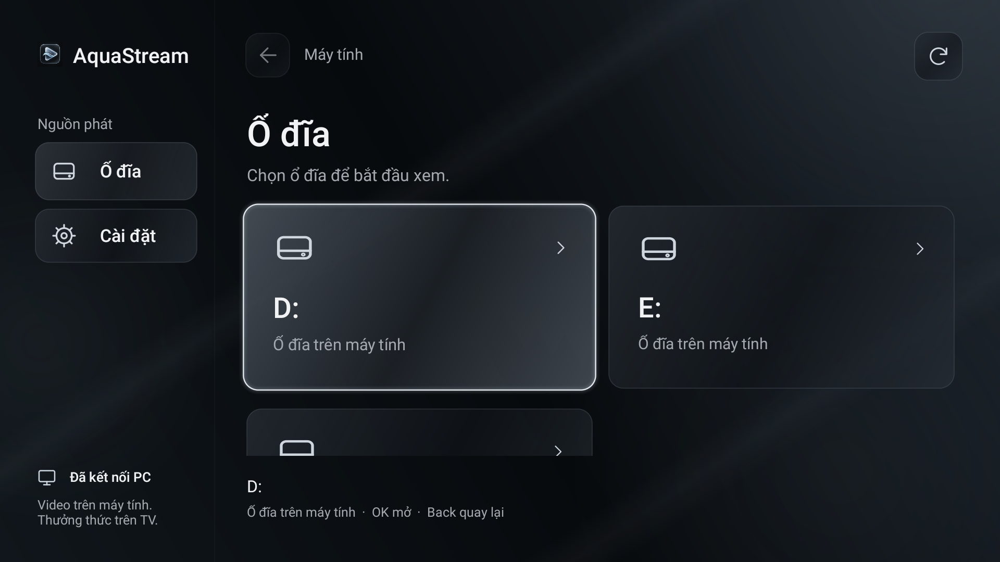
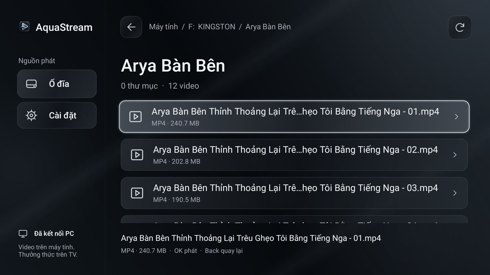
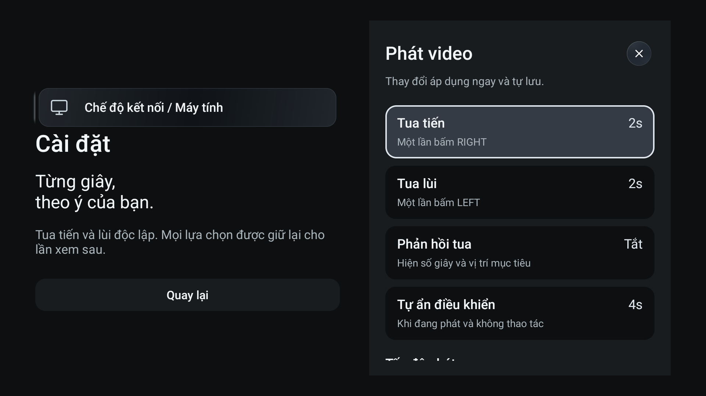
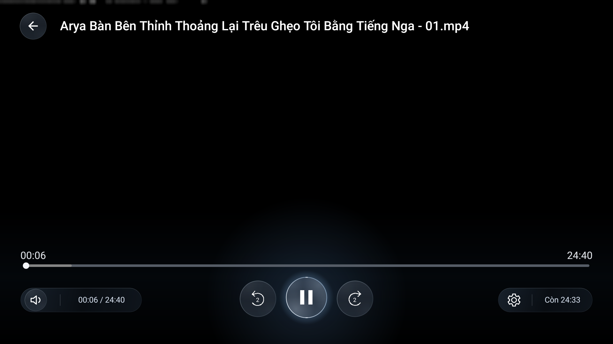

<div align="center">

# AquaStream

### Phim ở máy tính. Thưởng thức trên TV.

Phát video từ ổ đĩa Windows lên Android TV qua mạng nội bộ.<br>
Duyệt thư mục, chọn tập và điều khiển bằng remote ngay trên màn hình lớn.

**[Tải bản phát hành](https://github.com/mranex/TV_Ez_Stream/releases)** · [Cài đặt](#cài-đặt) · [Điều khiển](#điều-khiển-bằng-remote) · [Build từ source](#build-từ-source)

</div>



## Mở thư mục. Chọn phim. Xem.

AquaStream dành cho những bộ phim đã có sẵn trên PC hoặc ổ USB gắn vào PC. Windows Bridge đọc file tại chỗ và truyền video tới ứng dụng Android TV; TV giải mã bằng phần cứng của thiết bị.

Bạn giữ nguyên cách sắp xếp thư mục của mình. Không cần chép phim vào bộ nhớ TV, chờ quét thư viện hay chuẩn bị một bản video chuyển mã.

| Duyệt phim trên TV | Tùy chỉnh theo cách bạn xem |
| :---: | :---: |
|  |  |
| Thư mục quen thuộc, chữ lớn và focus rõ khi dùng remote. | Bước tua hai chiều độc lập; thay đổi được áp dụng và lưu lại. |

## Những thứ dùng mỗi ngày

**Duyệt đúng những gì bạn đã lưu.** Mở ổ đĩa, đi vào thư mục và chọn video. Thư mục được xếp trước file; tên có số được sắp theo thứ tự tự nhiên `1 → 2 → 10`. Khi quay về từ player, browser khôi phục vị trí và mục đang chọn.

**Tua theo nhịp của bạn.** Đặt riêng số giây tua tiến và tua lùi, giữ phím để tua liên tiếp hoặc đưa focus lên timeline để di chuyển xa hơn. Có thể bật phản hồi tua và chỉnh thời gian tự ẩn điều khiển.

**Tiếp tục buổi xem.** Lưu vị trí phát để xem tiếp, đổi tốc độ từ **0,25× đến 4,00×**, và tự chuyển tập khi nhận diện được tập kế tiếp từ tên file trong cùng thư mục.

**PC lo phần kết nối.** Bridge có GUI quản lý, chế độ chạy nền và tùy chọn khởi động cùng Windows. Với Legacy, watchdog kiểm tra ADB và khôi phục reverse mapping khi cần.

## Hai cách kết nối

| | Direct LAN | ADB Reverse · Legacy |
|---|---|---|
| Kết nối | PC và TV trong cùng mạng nội bộ | Qua kết nối ADB tới TV |
| Thiết lập | Tìm PC hoặc nhập địa chỉ, ghép đôi bằng PIN | Bật ADB trên TV, nhập IP và cổng ADB trong Bridge |
| Xác thực | Thông tin ghép đôi riêng cho từng thiết bị | Dựa trên kết nối ADB đã được cho phép |
| Cần ADB? | Không | Có |
| Phù hợp khi | Muốn dùng qua LAN mà không bật Developer Options | Đã có thiết lập ADB hoặc muốn giữ cách kết nối cũ |

Chọn cùng một chế độ ở cả PC và TV. Cài đặt cũ được giữ ở Legacy khi nâng cấp; ứng dụng không tự đổi chế độ khi kết nối thất bại.

## Cài đặt

Chuẩn bị một **máy Windows**, một **Android TV/TV Stick** và video lưu trên PC hoặc ổ USB gắn vào PC. Với Direct LAN, hai thiết bị cần truy cập được nhau trong mạng nội bộ.

### Windows

1. Tải gói Windows tại **[Releases](https://github.com/mranex/TV_Ez_Stream/releases)** và giải nén vào thư mục bạn muốn giữ lâu dài.
2. Mở `AquaStreamBridge.exe`, chọn **Khởi động Backend**.
3. Mở phần **Chế độ LAN / Ghép đôi**, chọn **Direct LAN** và kiểm tra địa chỉ mạng được hiển thị.
4. Nếu kết nối vào PC bị chặn, dùng chức năng Firewall trong GUI để cho phép AquaStream trên mạng **Private**.

EXE không cần cài Python. Có thể đóng GUI khi backend đang chạy; mở lại EXE để quản lý hoặc dừng backend. Tùy chọn khởi động cùng Windows nằm trong GUI.

### Android TV

1. Tải APK trong cùng trang Releases và cài lên TV.
2. Mở AquaStream, vào **Cài đặt → Chế độ kết nối / Máy tính**, chọn **Direct LAN**.
3. Tìm và chọn PC. Nếu không tìm thấy, nhập địa chỉ IPv4 hoặc hostname cùng cổng của Bridge; mặc định là **8765**.
4. Trên PC, chọn **Ghép đôi thiết bị mới**. Nhập PIN sáu số trên TV để hoàn tất kết nối.
5. Quay về màn hình ổ đĩa, mở thư mục và chọn phim.

<details>
<summary><strong>Thiết lập ADB Reverse / Legacy</strong></summary>

1. Bật Developer Options và ADB trên TV theo khả năng của thiết bị; cho phép PC kết nối khi TV hỏi xác nhận.
2. Giữ thư mục `platform-tools/` cạnh EXE nếu gói Windows có kèm, hoặc chọn đường dẫn `adb.exe` trong GUI Bridge.
3. Chọn **Legacy** trên cả Bridge và ứng dụng TV.
4. Nhập đúng IP và cổng ADB của TV trong Bridge. IP mặc định trong source là giá trị của máy phát triển, cần thay bằng thiết bị của bạn.
5. Dùng cùng HTTP port ở hai phía, mặc định **8765**. Watchdog sẽ thiết lập và kiểm tra reverse mapping.

Legacy chỉ mở HTTP trên loopback của PC. Nếu TV không bật lại ADB sau khi reboot, cần xử lý trên thiết bị trước khi Bridge có thể kết nối lại.

</details>

## Điều khiển bằng remote



| Vị trí | Thao tác | Kết quả |
|---|---|---|
| Đang xem, điều khiển đã ẩn | `LEFT` / `RIGHT` | Tua lùi / tiến theo số giây đã đặt; giữ để lặp |
| Đang xem, điều khiển đã ẩn | `OK`, `UP` hoặc `DOWN` | Hiện điều khiển, focus vào Play/Pause |
| Hàng nút điều khiển | `LEFT` / `RIGHT` | Chuyển giữa âm thanh, tua lùi, Play/Pause, tua tiến và Settings |
| Hàng nút điều khiển | `OK` | Kích hoạt nút đang chọn |
| Hàng nút điều khiển | `UP` | Đưa focus lên timeline |
| Timeline | `LEFT` / `RIGHT` | Tua theo timeline |
| Timeline | `DOWN` | Trở lại hàng nút điều khiển |
| Trong player | `BACK` | Ẩn điều khiển trước; khi đã ẩn thì quay về browser |

Mở Settings ngay trong player để chỉnh cách phát mà vẫn giữ phiên video hiện tại. Khi pause hoặc đang mở Settings, bảng điều khiển được giữ hiển thị.

## Một vài điều cần biết

<details>
<summary><strong>Không tìm thấy PC hoặc ghép đôi không kết nối được?</strong></summary>

Kiểm tra backend đã chạy, PC và TV đang chọn cùng chế độ, và địa chỉ LAN của PC là đúng. Với Direct LAN, thử nhập địa chỉ thủ công nếu mạng chặn discovery/multicast. Nếu nhập thủ công cũng thất bại, kiểm tra Firewall Windows, cổng Bridge và khả năng truy cập giữa hai thiết bị; mạng khách có thể cô lập các máy với nhau.

PIN ghép đôi có hạn sử dụng. Nếu đã hết hạn, tạo PIN mới trong GUI Windows.

</details>

<details>
<summary><strong>Video nào phát được? Tự chuyển tập hoạt động thế nào?</strong></summary>

AquaStream tập trung vào MP4 H.264/H.265. Khả năng phát MKV, codec âm thanh, HEVC 10-bit, độ phân giải và bitrate phụ thuộc phần cứng/decoder của TV. Bridge truyền file gốc và không transcode, nên không thể chuyển một định dạng mà TV không hỗ trợ thành định dạng khác.

Tự chuyển tập dựa vào tên file trong cùng thư mục. Tên có số tập rõ ràng, chẳng hạn `Series - 01.mp4` hoặc `Series S01E01.mp4`, giúp việc nhận diện hoạt động đúng.

</details>

<details>
<summary><strong>Cấu hình và lịch sử xem được lưu ở đâu?</strong></summary>

| Dữ liệu Windows | Vị trí mặc định |
|---|---|
| Cấu hình, nhận dạng máy chủ và ghép đôi | `%APPDATA%\AquaStream\` |
| Log xoay vòng | `%LOCALAPPDATA%\AquaStream\logs\` |
| Vị trí database xem tiếp | Được ghi trong `storage.json` thuộc thư mục cấu hình |

Cài đặt cũ có thể vẫn dùng database ở vị trí của bản Bridge trước. Khi cập nhật hoặc di chuyển thư mục, giữ dữ liệu cấu hình và kiểm tra `storage.json` trước khi xóa bản cũ. Tùy chọn phát và thông tin ghép đôi trên TV được lưu trong dữ liệu ứng dụng Android.

</details>

> [!IMPORTANT]
> **Dùng Direct LAN trong mạng tin cậy.** Kết nối hiện là HTTP không mã hóa. PIN và token giới hạn quyền truy cập nhưng không bảo vệ dữ liệu hoặc thông tin xác thực khỏi người có khả năng theo dõi mạng. Direct LAN hiện hỗ trợ IPv4; không mở cổng dịch vụ này ra Internet.

## Build từ source

Phần này dành cho người muốn tự build hoặc sửa ứng dụng. Người dùng bản EXE/APK chỉ cần làm theo mục [Cài đặt](#cài-đặt).

### Môi trường

| Thành phần | Yêu cầu |
|---|---|
| Windows Bridge | Windows, Python **3.12** có Tcl/Tk |
| Android | JDK **17 hoặc 21**, Android SDK Platform **35**, Build Tools **35.0.0** |
| Gradle | Wrapper **8.9**, được tải khi build lần đầu |
| Android app | minSdk **23**, targetSdk **28**; Kotlin Views và Media3 **1.5.1** |

```powershell
git clone https://github.com/mranex/TV_Ez_Stream.git
cd TV_Ez_Stream
```

### Chạy Bridge

```powershell
python -m venv .venv
.\.venv\Scripts\Activate.ps1
python -m pip install -r windows/requirements.txt
python windows/bridge.py
```

Dùng `python windows/bridge.py --background` để chạy backend không mở GUI.

### Đóng gói Windows EXE

Trong môi trường Python vừa tạo:

```powershell
python -m pip install -r windows/requirements-build.txt
powershell -ExecutionPolicy Bypass -File windows/build.ps1
```

Kết quả nằm ở `dist/windows/`. Script tìm ADB trong `PATH`; có thể truyền `-AdbPath "C:\path\to\adb.exe"` để kèm công cụ cho Legacy. Direct LAN không cần ADB.

### Build Android APK

Đặt `ANDROID_HOME` tới Android SDK. Nếu chưa đặt, script thử dùng `%LOCALAPPDATA%\Android\Sdk`. Có thể mở thư mục `android/` bằng Android Studio hoặc chạy:

```powershell
powershell -ExecutionPolicy Bypass -File android/build.ps1
```

Kết quả: `dist/android/AquaStream-debug.apk`. Để build rồi cài lên một thiết bị ADB:

```powershell
powershell -ExecutionPolicy Bypass -File android/build.ps1 -Install -DeviceSerial "YOUR_ADB_SERIAL"
```

APK tự build dùng khóa debug của môi trường build. Muốn cập nhật đè bản đang có trên TV phải dùng cùng khóa ký; repository không chứa khóa riêng của bản phát hành.

### Chạy tests

```powershell
python -m unittest discover -s tests -p "test_*.py" -v
.\android\gradlew.bat --project-dir android testDebugUnitTest
```

Các bài Python kiểm tra HTTP Range, duyệt file, progress, watchdog, ghép đôi và chuyển chế độ. Android JVM tests kiểm tra logic seek, buffer, trạng thái player và nhận diện tập. Kiểm thử phần cứng/codec và phiên xem dài cần thực hiện trên TV thực tế.

### Bản đồ mã nguồn

| Đường dẫn | Vai trò |
|---|---|
| [`android/app/src/main/`](android/app/src/main/) | Browser, player, giao diện điều khiển và kết nối TV |
| [`android/app/src/test/`](android/app/src/test/) | Android JVM unit tests |
| [`windows/`](windows/) | HTTP Bridge, GUI, LAN, ghép đôi, watchdog và lưu tiến độ |
| [`tests/`](tests/) | Python unit và integration tests |
| [`assets/screenshots/`](assets/screenshots/) | Ảnh giao diện dùng trong README |

## Giấy phép

Phát hành theo [Apache License 2.0](LICENSE).
